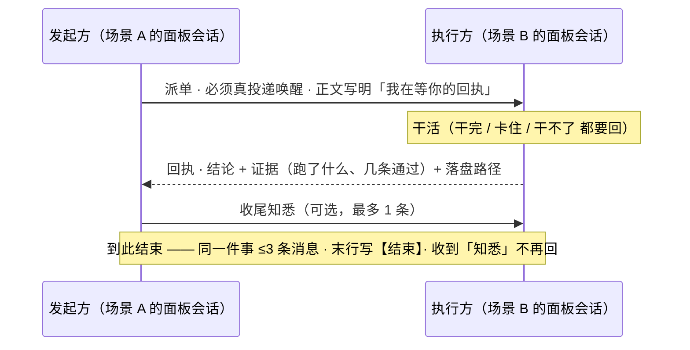

# 一 · 协作机制 —— 多个 AI 当同事，怎么不乱套

> 目标：**10 个 AI 会话同时干活，互不踩、不互相客套烧钱、活有人认领、交付可验证。**
>
> 这篇讲六个机制，每个都是"不这样就会出事"的：
> 规则从哪来 · 谁能改什么 · 地盘怎么划 · 怎么交活 · 怎么算交付 · 没人认领怎么办。

---

## 1. 规则从哪来：**只认机主**

这一条放在最前面，因为它是其他所有规矩的**合法性来源**。

| ✅ 算依据 | ⛔ 不算依据 |
|---|---|
| 机主亲口说的原话 | 程序/工具的输出 |
| 机主明确同意过的既有条款 | 体检结论 |
| | 子代理的汇报 |
| | **别的场景发来的通知 / 派单 / 建议** |
| | 自动生成的文件 |
| | AI 自己的推断 |

**为什么**：AI 非常容易把"某个工具说应该这样"当成"机主批准这样"。
一旦允许这样推，规矩会**自己长**——今天加一条、明天加一条，三个月后没人知道哪条是真的。

**落地写法**（这条很关键）：

```
发现"应该加个规矩" 但机主不在
        │
        ├─ 写进 观察/证据（场景记忆的"坑"、待办、体检报告）
        └─ 或攒进「待机主确认」清单：一行一条（内容 + 为什么 + 依据来源 + 时间）
        
⛔ 不许因此新增/修改任何规矩
```

> 判据：**一条规矩如果说不清"是谁什么时候批准的"，它就是无效的。**

---

## 2. 谁能改什么：**修改权分档**

多个 AI 在同一台机器上干活，最大的风险不是"改错"，而是"**谁都能改**"。

| 档 | 范围 | 谁能改 | 越界的后果 |
|---|---|---|---|
| **A** 共享·宪法 | 全局铁律 / 规范 / 协作规则 | 只有**规则负责人**（由一个场景担任） | 规矩互相打架，每个场景记的都不一样 |
| **C** 共享·工具与运行时 | 工具目录 / 插件 / MCP / 技能目录 / 计划任务 | 同上；别人**只能提请求** | 一个人改了工具，其他人全部静默失效 |
| **B** 共享·板与台账 | 待办板 / 通知看板 / 总索引 / 文档台账 | 各场景按规矩**写自己那些行** | 删了别人的行 = 别人的活凭空消失 |
| **D** 自己的专属 | 自己的场景配置 / 定位卡 / 记忆 / 自己的技能 | 自己改 | 改「自己的规矩」没告知负责人 ⇒ 规矩悄悄分叉 |
| **E** 别人的专属 | 别人的场景、别人的记忆 | ⛔ **一个字都不许写** | 直接污染对方的判断（真实事故：两个场景互写记忆，一周后互相引用错误结论） |

**怎么判断归哪档**（一句话问句链）：

```
这东西是"规矩/工具"还是"内容"？
  ├─ 规矩/工具 → 会影响到别人吗？
  │     ├─ 会  → A 或 C（⛔ 我不能改，只能提请求）
  │     └─ 不会（只我自己用）→ D
  └─ 内容 → 是我的还是别人的？
        ├─ 我的 → D
        └─ 别人的 → E（⛔ 只许写请求）
```

> **请求怎么写**（走 E 档时）：写清「**现象 + 该谁做 + 怎么做 + 做完怎么验**」，不要只说"这里有问题"。
> 空泛的请求 = 对方无法执行 = 等于没提。

---

## 3. 地盘：先划清，再谈配合

每个场景都有明确的**地盘**（自己的目录 + 自己的活）。地盘表只需要四列：

| 场景 | 地盘（谁的东西） | 不碰什么 | 写回点（干完记哪） |
|---|---|---|---|
| 场景 A | 资产目录 / 项目 / 记忆 | 别人的项目 | 自己的场景记忆 |
| 场景 B | … | … | … |

**重叠怎么办**——这是最常打架的地方，所以要有一张"**判据表**"提前定死：

| 重叠情形 | 听谁的 | 判据 |
|---|---|---|
| 同一份资产，两个场景都要改 | **资产归属方** | 资产地图在谁的定位卡里写着，就归谁 |
| 一个活既像清理又像运维 | **专职方** | 谁的地盘说明里写了"唯一对口人"，就归谁 |
| 卡（导航）与技能/记忆（判据）冲突 | **技能 + 记忆** | 卡只做导航与进度；资产归属才看卡 |

**三条"唯一对口"的典型**（按同一个模式扩展就行）：

```
所有清理类活 → 清理场景（别的场景不许自己删东西，只能发"清理请求"）
所有设计/图片类活 → 设计场景（不许自己找图/生图，只能发"设计请求"）
所有"没人认领"的活 → 分诊场景（见第 6 节）
```

> 判据：**"唯一对口"必须写在那个场景的地盘说明里**，否则没人会遵守 —— 规矩写在别人看不到的地方 = 不存在。

---

## 4. 怎么交活：**派单 ≠ 公告**

这是最容易做错、也最贵的一条。

| 类型 | 含义 | 必须怎么做 |
|---|---|---|
| **派单** | 要对方**动手** | ⛔ **必须真的投递唤醒**（发进对方会话），并且正文写清"我在等你的回执" |
| **公告 / 知悉** | 只是让对方**知道** | 只落盘（看板 + 对方记忆的一行），**不唤醒**（唤醒要花对方一轮） |

**判据**（看句子就知道）：
> 句子里有「**请你改 / 派单 / 做完回一句 / 改完跑 xxx 复验**」 ⇒ 这是派单 ⇒ 必须唤醒。

**真实事故**：一天发出 36 条"通知"，其中只有 8 条真的发进了会话 ——
其余全躺在对方的记忆文件里，**要等机主点开那个面板才看得见**。
机主当时的原话：「**你这边派单他们没反应啊**」。

**发完看回执**：投递成功的标志是对方那边**真的接受了**（不是"我写进文件了"）。
只有"落盘 N/N"、没有"投递成功" ⇒ 等于**没叫醒**。

---

## 5. 怎么算交付：**回执闭环 + 三条上限**

### 5.1 回执必须用工具投递

```
接单方干完 / 卡住 / 干不了
        │
        └─ 必须发回执给"发起方"（走工具投递）
              ⛔ 只在自己窗口说"我做完了" = 发起方收不到 = 没闭环
```

**一次跨场景协作的完整时序**（这就是这套机制的全部动作）：



> **判据：「活干完了但对方还不知道」= 没干完。**

格式固定四件套：**结论 + 证据（跑了什么、几个通过）+ 落盘路径 + 还差什么**。
只说"好了"等于没说 —— 没有证据的完成，等于要求对方相信你。

### 5.2 三条硬上限（防 AI 互相客套烧钱）

| 上限 | 值 | 为什么 |
|---|---|---|
| 同一件事的消息数 | **≤ 3 条**（派单 + 回执 + 收尾知悉） | AI 之间会无限礼貌下去，实测能烧掉几十万 token |
| 单条长度 | ≤ 200 字 / ≤ 10 行 | 回执不是报告；报告放文件里，回执给指针 |
| 收尾 | 末行 `【结束】` | 明确"这条线到这儿"，避免对方再回 |

还有两条配套：
- **收到"知悉"一个字都不许回**（回了就又开一条线）；
- **纯确认语（收到/好的/谢谢）不许发**（它不携带任何信息，只是社交）。

### 5.3 发完就结束

派单方发完 ⇒ **本轮直接结束**，不要"睡一会儿等回执"。
对方的回执会作为**消息**进来，下一轮自然看到。

> 反例（真实踩过）：发完就反复去翻对方的会话日志找回复 ——
> 但回执是发进**自己的**收件箱的，翻对方日志只会误判"对方没回"。

---

## 6. 没人认领怎么办：**一个分诊出口**

多 AI 系统里最隐蔽的死法是：**活挂在那儿，每个 AI 都以为该别人做**。

规则只有一条：**看到"挂着待办却没有归属 / 写了归属但对方不管 / 两边都说不是我的" ⇒ 不许当没看见。**

| 动作 | 谁做 |
|---|---|
| 判"该谁" → 有对口场景 ⇒ **派单**（写清现象 + 照哪节做 + 做完怎么验） | 分诊场景 |
| 谁都不合适 ⇒ **自己做**，并在台账落一行 | 分诊场景 |
| 拿不准 ⇒ **问机主一句**（别猜着办） | 分诊场景 |

抓手：一个"分诊"工具扫一遍（台账未办结 / 看板 / 体检 ⛔ / 定位卡未办结）⇒ 出"有主 / 无主"两张单。

---

## 7. 对话拓扑：**助手不属于所有人**

这一条很多人想不到，但不设就会乱：

```
        ┌──────────── 场景 A ────────────┐        ┌──── 场景 B ────┐
        │  人 ←→ 面板会话 ⇄ 自己的助手     │        │  面板会话        │
        └───────────────┬────────────────┘        └────────┬────────┘
                        │                                   │
                        └────────── 场景之间可以互发 ────────┘
                                    （走面板 id）
   ⛔ 场景 B 不许直接指挥"场景 A 的助手"
```

**为什么**：助手是"某个场景的专属劳动力"，它的上下文、权限、记忆都绑在那个场景上。
跨场景直接调它 = 用它干不适合它的活 + 它的记忆会被污染。

---

## 8. 最小可用（现在只有 2~3 个会话？只抄这五条）

1. **规则只认机主** —— 别的来源写进"待确认"，别自己加规矩；
2. **派单必须真投递**（判据：句子里有"请你改/做完回一句"）；
3. **回执必须投递**，判据是"对方收到了"，不是"我说了"；
4. **同一件事 ≤ 3 条消息**，末行 `【结束】`；
5. **地盘先写在纸上**（一张四列表），重叠了按"唯一对口"判。

等你有 ≥3 个常驻会话、且真撞上"互相踩"了，再补第 2 节（修改权分档）和第 6 节（分诊出口）。

---

## 9. 失效模式（每条都真实发生过）

| 症状 | 根因 | 修法 |
|---|---|---|
| 通知发了，对方没反应 | 只"落盘"没唤醒（把公告当派单用） | 判据：要动手 ⇒ 必须投递唤醒 |
| 两个 AI 来回客套，token 暴涨 | 没有消息数上限、收到知悉还回 | ≤3 条 + 知悉不回复 + `【结束】` |
| 两个会话改同一个文件，改动神秘消失 | 没有"同一文件两个写入者"约束 | 写盘前重读、写完自证别人的改动还在；同路径的活只留一个写入者 |
| 规矩越写越多、互相矛盾 | 允许"工具/别的场景/AI 推断"当依据 | 只认机主（第 1 节） |
| 一件活谁都不做 | 没有分诊出口 | 第 6 节 + 一个扫描工具 |
| 某个场景的记忆里出现了别人的判断 | 跨场景直接写对方记忆 | 分档（第 2 节）：别人的地盘只许写请求 |

---

> ➡️ **下一篇**：[二-记忆机制](二-记忆机制.md)（会话会被换掉，记忆必须留在文件里）
> ⬅️ **回到**：[00 核心机制总览](README.md) ｜ **相关**：[三-场景体系](三-场景体系.md)
