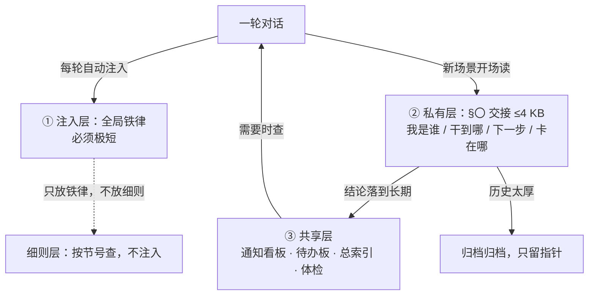

# 二 · 记忆机制 —— 会话会被换掉，记忆必须留在文件里

> 一条 AI 会话是有寿命的：上下文会满、会被压缩、会被换掉、会因为一次升级而重启。
> **所有"只存在对话里"的东西，都会在某一天消失。**
>
> 这套机制只干一件事：**让"记忆"不依赖会话而存在。**

---

## 1. 核心前提：记忆在文件，不在会话

| 做法 | 结果 |
|---|---|
| 靠对话历史记着"我干到哪了" | ❌ 一换会话就断片；压缩之后细节也没了 |
| 靠 AI 自己"记得" | ❌ 它记不住；它只会在上下文里看到什么就以为是什么 |
| **靠文件里的交接** | ✅ 会话换一百次，记忆都还在 |

**推论（很重要）**：一条会话的价值 = 它**产出的文件**，不是它聊了多少。
所以"换会话"不是灾难，**没写交接就换**才是灾难。

---

## 2. 三层结构：为什么必须分层

```
┌─ ① 注入层（全局铁律）─────────────────────────────┐
│  每轮对话自动注入。人人都在付这个成本 ⇒ 必须极短     │
│  只放"不读就会白干"的铁律，⛔ 不放教程和细则         │
└──────────────────────────────────────────────────┘
┌─ ② 私有层（每个场景的 §〇 交接，≤ 4 KB）──────────┐
│  我是谁 / 干到哪 / 下一步 / 卡点 / 细节在哪          │
│  只有本场景开场读 ⇒ 换会话时它是唯一入口             │
└──────────────────────────────────────────────────┘
┌─ ③ 共享层（板 / 台账 / 体检）────────────────────┐
│  发生了什么 · 该做什么 · 东西在哪 · 机器健康吗        │
│  不属于某个场景，谁需要谁读                          │
└──────────────────────────────────────────────────┘
```

**三层怎么流动**：



**为什么不能合成一份**：

| 合一之后的后果 | 具体数字 |
|---|---|
| 注入层变长 ⇒ **每轮都更贵** | 注入 60 KB ≈ 每轮多付 20k token；一天几十轮就是灾难 |
| 私有层变长 ⇒ **开场读不完** | 曾经有一份场景记忆涨到 40 KB，结果没人读，交接形同虚设 |
| 共享层混进私有内容 ⇒ **互相干扰** | 别人的进度挤进你的开场，你读到一堆与你无关的东西 |

> 判据：**"这东西谁会读？多久读一次？"**
> 每轮都读 ⇒ 注入层（必须极短）· 每场开场读 ⇒ 私有层（≤4 KB）· 需要时才查 ⇒ 共享层或按需文档。

---

## 3. 私有层：`§〇 交接` 到底写什么

每个场景的记忆文件，第一个小节固定是「当前交接」，**覆盖写**（不是追加），只留最新一份：

```markdown
## §〇 当前交接（换会话 / 新会话必读）

- 身份：面板 <面板id> · 场景 <场景id> · <日期> 第 N 轮写
- 上次进度：<这轮做了什么、产物在哪>          ← 一句话 + 指针
- 下一步：① … ② …
- 卡点：<没有就写"无">
- 细节在哪：技能 <名> · 项目档案 <路径> · 归档 <路径>
```

四条硬规矩：

| 规矩 | 为什么 |
|---|---|
| **只留最新一份**（覆盖，不追加） | 追加会无限长；"上次进度"只有一份是有意义的 |
| **≤ 4 KB** | 超了就没人读；4 KB 约等于"看 30 秒就能开工" |
| **每轮最新，旧的搬 `归档\`** | 历史不能丢，但不能占着入口 |
| **写"指针"不写"全文"** | 细节放项目档案/技能里，这里只写"在哪" |

> ⚠️ 最常见的错误：把 `§〇` 写成**周报**（今天做了 1、2、3、4、5 件事，每件三大段）。
> 结果：一是超线，二是新会话读完之后仍然不知道"下一步该干什么"。
> **`§〇` 的回答只有四个：我是谁 / 干到哪 / 下一步 / 卡在哪。**

---

## 4. 共享层：四块板，各回答一个问题

| 板 | 回答 | 谁写 | 生命周期 |
|---|---|---|---|
| **通知看板** | **发生了什么**（跨场景公告 / 派单 / 回执） | 发通知的工具自动写 | 最新在上；每场景只在自己记忆里留 ≤5 条摘要 |
| **待办板** | **该做什么**（全机唯一落点） | 任何场景加一行，同一件只许一行 | 做完删行；挂起太久搬归档 |
| **总索引 / 文档台账** | **东西在哪**（场景 ↔ 记忆 ↔ 卡 ↔ 技能；文档状态与复核日期） | 新建/移动时就登记 | 四状态：活 / 常备（180 天）/ 留档 / 待清（7 天） |
| **体检结果** | **机器健康吗**（一个固定名 JSON + 一份报告覆盖写） | 体检工具 | 只显示上一次 |

**为什么板要分开**：它们**更新频率不同**（看板一天几十条、索引一周几条、体检一周一次）、
**读者不同**（看板人人看、索引偶尔查）、**责任不同**（看板谁发谁写、索引谁建谁登记）。
混在一起的结果是：更新最频繁的那块把所有东西都挤没了。

---

## 5. 写回判据：什么该记，什么不该记

**只有"实质工作"才写回**：

| ✅ 记 | ⛔ 不记 |
|---|---|
| 建/改了一个应用、修了一个 bug | 搜索结果 |
| 写了一份报告/文档 | 临时路径 |
| 重构 / 架构变更 | 工具报错原文（要记就记"症状→根因"） |
| 选定了一个技术方案 | 一次性约束（"这次先这样"） |
| 机主分享的约定 | 聊天过程 |

**量也有上限**：每次写回 **≤10 行 / ≤2 KB**。
超了说明你在抄过程，而不是记结论 —— 过程属于当轮的对话，结论才属于记忆。

> 判据：**"三个月后我还会需要这一行吗？"** 不需要就别写。
> 记忆的价值不在于"全"，在于"**下次开工能 30 秒接上**"。

---

## 6. 体量红线与到线动作（记忆会发胖，必须减肥）

| 对象 | 红线 | 到线怎么办 |
|---|---|---|
| 场景记忆主文件 | **≤ 25 KB** | 把旧轮次、旧决策搬进 `归档\`，主文件只留入口 + 指针 |
| `§〇 交接` | **≤ 4 KB** | 同上：历史搬走，只留"最新一份 + 指针" |
| 技能（单篇） | **≤ 12 KB** | 拆成"主文件 + reference 子文件" |
| 注入层（全局铁律） | 越短越好 | 细则全部下沉到"规范"层（不注入，按需查） |

**减肥的硬要求：只搬不丢，而且必须能证明。**

```
① 先存一份"搬之前"的快照
② 搬（历史 → 归档\）
③ 跑核对脚本：逐行比对"搬前非历史行 == 搬后非历史行"
      命中 0 差异 ⇒ 才算没丢
④ 跑索引体检：死条目 / 未登记 / 过期 / 身份漂移
```

> 真实教训：有一次没存快照就动手拆，结果**核对脚本根本跑不了** —— 你无法证明自己没丢东西。
> 从那以后规矩改成：**先快照，再动手。**

---

## 7. 换会话协议（这套机制里最实操的一条）

```
① 先把「进度 / 下一步 / 卡点」覆盖写进 §〇     ← 这一步就是"交接"，别省
② 再换（新建会话 + 旧会话归档）
③ 换完同步三处：
     · 场景配置里的 sessionId / sessionTitle
     · 身份索引表的会话 id 列
     · §〇 里的交接署名（"本交接由会话 <新id> 于 <日期> 改写"）
④ 跑自检：逐面板应打印"✓ id 命中（身份校验通过）"
```

**为什么第 ③ 步不能省**：面板是按 `sessionId` 钉会话的。不同步 ⇒ 面板指向一条**已归档的会话**，
表现为"切到这个场景，AI 像换了个人"（其实就是换了个人）。

**什么时候才该换**（这条很反直觉）：

| 触发 | 换吗 |
|---|---|
| 机主说「换会话」 | ✅ 换 |
| 上下文超限（报 413）且**压缩之后仍然** 413 | ✅ 换（真死局） |
| 只是"到压缩线了"、还没报错 | ❌ **不换** —— 引擎会自动压缩，继续干 |
| 任务做完了 | ✅ 建议换（一个话题一个会话） |

---

## 8. 会话档案：聊天全文在哪

记忆机制只管"结论"，不管"聊天记录"。聊天全文另有去处（归档 + 索引）：

- 归档：定期把会话数据快照到备份目录（保留最近 N 份）；
- 索引：一份"会话档案"说明**每个面板的对话文件在哪、怎么读**（三种读法：按会话 / 按日期 / 按关键词）；
- 分级：重要场景（自我复盘类、改造类）留关键信息；其它场景只记大概。
  ⛔ 别把聊天正文抄进记忆文件 —— 那是两回事。

---

## 9. 失效模式（都真实发生过）

| 症状 | 根因 | 修法 |
|---|---|---|
| **记忆越写越肥，最后没人读** | 把过程、搜索结果、报错原文都写进去 | 写回判据（第 5 节）+ 体量红线（第 6 节） |
| **两份数字打架**（记忆说 A，台账说 B） | 同一事实存在两处 | 单一权威：一个事实只存一处，另一处只放指针 |
| **切换场景后"失忆"** | `sessionId` 指向旧会话 | 换会话协议第 ③ 步 |
| **别人的判断出现在我的记忆里** | 跨场景直接写对方记忆 | 协作机制的分档：别人的地盘只许写请求 |
| **"体积正常"但内容没用** | 只盯体量，不看"读完能不能开工" | 判据改成：新会话读完 §〇，**30 秒内能不能说出"下一步干什么"** |
| **压力数字骗人** | 拿"会话占用百分比"当压力（它不含工具定义，低估 2~3 倍） | 只信专门的体检工具当场那一条 |

---

## 10. 最小可用（先只做这四件）

1. **每个场景一份记忆文件**，第一个小节固定写 `§〇 交接`（身份/进度/下一步/卡点）；
2. **换会话之前必须先写 `§〇`**（写不出"下一步"说明这轮白干了）；
3. **`§〇` 控制在 4 KB 内**，超了把历史搬进 `归档\`；
4. **只记结论，不记过程**（≤10 行/次）。

等你有 3 个以上场景、且开始"同一个事实两处不一致"了，再来补共享层四块板（第 4 节）。

---

> ➡️ **下一篇**：[三-场景体系](三-场景体系.md)（一个场景 = 一类会反复回来的活）
> ⬅️ **回到**：[00 核心机制总览](README.md) ｜ **相关**：[一-协作机制](一-协作机制.md)
