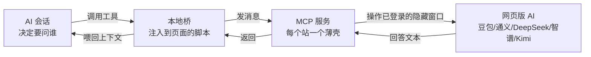

# 整体架构 —— 为什么"网页版 AI"能变成本地工具

> 目标：**不花 API token**，让本地 AI 能调用"网页版 AI"（豆包 / 通义 / DeepSeek / 智谱 / Kimi）。
> 做法不是破解接口，而是**复用一个已经登录的浏览器会话**：把它当成人来用 —— 输入、等它说完、把话取回来。

---

## 1. 四层：缺一不可



| 层 | 是什么 | 关键点 |
|---|---|---|
| **A 会话层** | 你的 AI 会话决定"这个问题问谁" | 它看到的是一个**普通工具**，不知道背后是网页 |
| **B 本地桥** | 注入到工作台页面里的脚本 | 负责"页内 ↔ 主进程"的转发（页面不能直接起进程） |
| **C MCP 服务** | 每个站一个薄壳（`webai-doubao` / `webai-tongyi` / …） | 只做三件事：输入 → 等稳定 → 取文本 |
| **D 网页版** | 一个**已登录**的浏览器窗口（通常是隐藏的） | 登录态是整套东西的前提，也是它最脆的地方 |

> 内核只有一份，**加一个站 ≈ 加一个薄壳对象**（见 [`怎么加一个站.md`](怎么加一个站.md)）。

---

## 2. 为什么能"零成本"

| 你花的是 | 不是 |
|---|---|
| 你已经付过的**订阅额度** | 按 token 计费的 API |
| 本地一点 CPU/内存（跑一个隐藏窗口） | 云端推理费 |

代价必须说清（这也是它"只能干轻活"的原因）：

| 代价 | 表现 |
|---|---|
| **慢** | 一次问答几十秒；不适合长任务、不适合批量 |
| **脆** | 对方改一次 DOM，你的选择器就过期 |
| **不能并发** | 同一个站两个页面同时问答，几乎必然串话 |
| **依赖登录** | 掉登录就全挂；风控弹验证码也全挂 |

> 判据：**它适合"问一次、要一段文字"**；不适合"跑一百次"或"必须准时"。

---

## 3. 三个设计决定（值得抄）

### ① 薄壳很薄：站点差异只在一个对象里

```js
export const site = { id, name, url, loggedIn, inputSel, send, answerSel, wait, profileDir };
```

流程代码（输入 → 等第一段 → 等稳定 → 取文本）**所有站共用一份**。
加站不用碰流程，只填这个对象 ⇒ 加站成本从"半天"降到"十几分钟"。

### ② 等待要分两步：先等"出现"，再等"不再变"

```
第一次等到文本出现 ⇒ 只是"它开始说了"
等文本 stableMs 内不再变化 ⇒ 才是"它说完了"
```

只等"出现"会拿到半句话 —— 这是最常见的实现错误。见 [`排障.md`](排障.md)。

### ③ 登录态用**持久化 profile**，不做"自动登录"

- 第一次手动登录一次，之后复用 profile 目录；
- ⛔ 不要在代码里模拟登录：几乎必触发风控，而且出问题时你无法判断是谁的错。

---

## 4. 两个前提（否则一定失败）

| 前提 | 检查方法 |
|---|---|
| **那个窗口真的登录着** | 打开同一 profile 手动访问一次，能看到输入框 |
| **选择器还对着** | 每个站至少要能通过"输入框 / 发送 / 回答容器"三个选择器的自检 |

> 这两条不成立时，**报错要直说**（"未登录"、"取到空回答（选择器可能过期）"），
> 不要静默返回空字符串 —— 空字符串会被上层当成"AI 说没有"，然后你排查半天。

---

## 5. 常见误解（先掐掉）

| 误解 | 事实 |
|---|---|
| "这就是爬虫/破解接口" | 不是。它是**驱动一个已登录的浏览器**，和你手动打字等价 |
| "可以拿它跑批量任务" | 不建议。慢、易掉登录、易触发风控 |
| "接了就一定省钱" | 省的是 token 钱，付的是**时间**与**维护成本**（选择器会过期） |
| "可以并发开 5 个站一起问" | 可以（不同站），但**同一个站别并发** |

---

> ⬅️ 回 [03 · MCP 接免费 AI](README.md) ｜ 下一篇 ➡️ [怎么加一个站](怎么加一个站.md) ｜ 排障 ➡️ [排障](排障.md)
