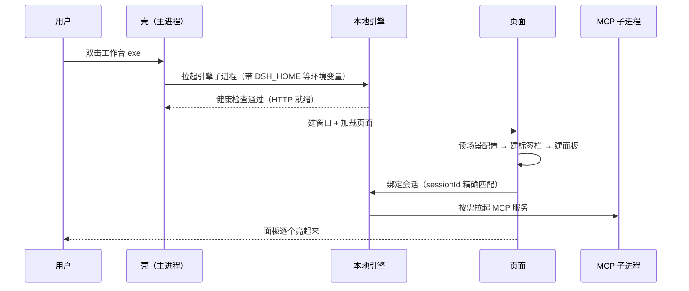

# 技术栈与启动链路 —— 谁先起、谁拉起谁、出事查哪层

> 多进程桌面 AI 工作台最容易浪费时间的场景：**界面白着，你不知道是壳坏了、引擎坏了、还是会话没了。**
> 这一篇给你一张"层 → 症状 → 先查什么"的表。

---

## 1. 有哪几个进程

```
┌────────────────────────────────────────────────────────────┐
│ ① 壳（主进程，Electron main）                                │
│    · 建窗口、管场景、连 IPC、拉起引擎                          │
│    · 改它 ⇒ 必须重启整个工作台                                 │
├────────────────────────────────────────────────────────────┤
│ ② 渲染层（页面）                                             │
│    · renderer/*.js（页面骨架）+ renderers.js（各面板实现）      │
│    · 改 renderers.js / styles.css ⇒ 重载即可（热）             │
├────────────────────────────────────────────────────────────┤
│ ③ 本地引擎（HTTP 服务，默认 127.0.0.1:3080）                   │
│    · 会话、模型调用、技能、插件 …                              │
│    · 改它 ⇒ 构建 + 重启引擎（⛔ 别自己关，会让所有会话断）        │
├────────────────────────────────────────────────────────────┤
│ ④ MCP 子进程（每个服务一个）                                  │
│    · 工具能力的实际执行者；崩了只影响对应工具                    │
└────────────────────────────────────────────────────────────┘
```

**关键认知**：①② 和 ③ 是**两套东西**，各自会死。所以"界面白"和"AI 不回答"是两类完全不同的故障。

---

## 2. 启动链路（一次双击发生了什么）



**四个可能卡住的点**（都在上图的箭头上）：

| 卡在 | 现象 |
|---|---|
| 引擎没起来 | 界面能开，但 AI 面板一直"连接中" |
| 健康检查没过 | 壳等引擎超时，窗口可能根本不出 |
| 页面建面板失败 | 某一格永远空白（该面板类型的渲染器抛错） |
| 会话绑定失败 | AI 面板让你"自己选一条"（`sessionId` 找不到） |

---

## 3. 生效方式：三种改动的三种代价

| 你改了什么 | 怎么生效 | 代价 |
|---|---|---|
| `renderers.js` / `styles.css` / 场景 json | **热重载**（提供刷新入口或自动） | 秒级 |
| `renderer/renderer.js` / `main.js` / `preload.js` | **重启工作台** | 十几秒 + 所有会话断一次 |
| 引擎源码 / 插件 / 配置里的新插件行 | **构建 + 重启引擎** | 分钟级，且**只能由机主点** |

> 这条决定了你的开发节奏：**能放 `renderers.js` 的就别放 `renderer.js`**。
> 这也是["顶栏交互放热更新侧"](../07-顶栏与菜单栏/README.md) 那个设计决定的原因。

---

## 4. 出事查哪层（按症状）

| 症状 | 先查 | 再看 |
|---|---|---|
| 窗口出不来 / 一闪就退 | 壳的日志（`server.log`） | 引擎是否被拉起 |
| 面板全白（连标签栏都在，但每格空） | `server.log` 有没有 `launch-failed` | exe 是否被替换过（入口哨兵） |
| 只有某一格白 | 该面板类型对应的渲染器 | 控制台报错 |
| 界面正常，AI 不回答 | 引擎健康（HTTP 通不通） | 模型供应商是否被限流 |
| 会话"不见了"（让你重选） | `sessionId` 是否还存在于会话库 | `DSH_HOME` 指向对不对 |
| 一切正常，但"改的代码没生效" | 生效方式选错（见 §3） | 是否加载了旧的注入脚本 |

> ⛔ **最重要的判据**：`server.log` 里有没有 `launch-failed`。
> 有 ⇒ 先解决壳；没有 ⇒ 才轮到业务层。

---

## 5. 目录约定（哪放什么）

| 放什么 | 放哪 | 理由 |
|---|---|---|
| 场景配置、定位卡 | `scenarios/` | 壳按目录扫描 |
| 面板渲染器、样式 | `renderer/` | 渲染层整体重载 |
| 主进程脚本（备份/自检/换会话） | `scripts/` | 与壳同生命周期外 |
| 运行期数据、备份 | `data/` | ⛔ 别放仓库根（会进 git） |
| 第三方驱动本体 | 固定的驱动目录 | 只放本体，**别放脚本** |
| MCP 服务本体 | 固定的 MCP 目录 | 同上 |
| 素材、产物、小工程 | **项目盘**（不在程序目录里） | 程序目录要能整体替换 |
| 临时文件 | 系统临时目录 | 需要留的才建带时间的专属夹 |

---

> ⬅️ 回 [04 · 工作台搭建](README.md) ｜ 上一步 ➡️ [从零到能跑](从零到能跑.md) ｜ 下一步 ➡️ [自检清单](自检清单.md)
