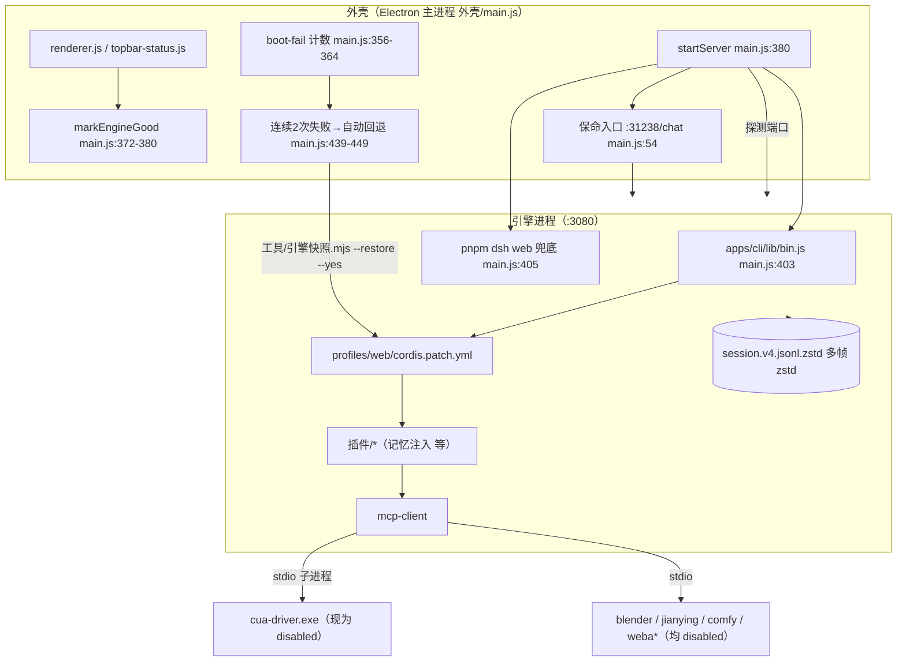
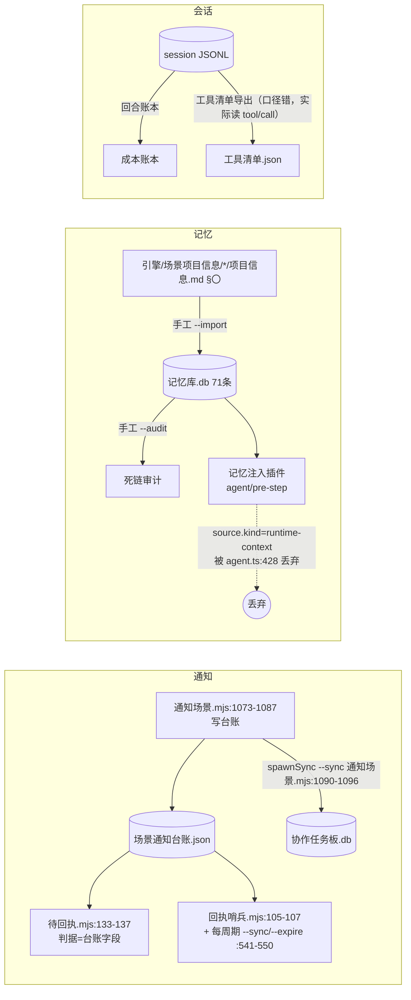

# DSH 本轮改动审查（第五轮 · 架构诊断 + 对抗性审查）

时间：2026-10-21 21:00 起 · 审查对象：第四轮落地的 8 项
方法：读源码给 `文件:行`；每个数字都在本机现量，附可复跑命令；与第四轮结论冲突处单列。

---

## 0. 一句话结论

**8 项里只有 1 项是真正成立的（工具裁剪，且今天一次都没跑过），2 项是"假实现"（记忆注入、工具清单导出），5 项有实打实的缺陷。**

最严重的一条不是"没做"，而是**做了、日志说成功了、模型一个字节都没收到**：

- `记忆注入.log` 今天 **9 条全是 `inject`，0 条 skip**（21:05 现量）；
- 但这一整场 12 MB / 14,900 条事件 / 127 回合的会话里，`user/message` 中**一次都没出现过"记忆提示"**（只在 `tool/result`/`assistant/message` 里出现过，那是我写脚本时的文本）；
- 根因：注入消息声明了 `source.kind = 'runtime-context'`，而引擎把这种 kind 当作**自己的**快照占位符，正文被直接丢弃（`core/agent-loop/src/agent.ts:426-436`）。

也就是说：**这个东西现在的作用是"每回合往日志里写一行 inject"**。第四轮报告里"93.4% 命中 / 28.6% 真注入"的 28.6% 也应该修正为 **0%**——那 28.6% 是"插件以为自己注入了"。

---

## 1. 本轮量具（数字 + 复跑命令）

| 指标 | 现量值 | 复跑方式 |
|---|---|---|
| 当前会话帧 / 事件 / 字节 | 8,873 帧 / 14,900 条 / 33.9 MB | `tools/回合账本.mjs:23-33` 解多帧 zstd |
| 当前会话回合（turn/start） | 127（turn/end 126，末回合进行中） | 见 §4 |
| 当前会话 `request/header` | 41 次 | 同上 |
| **最后一次 header 工具数 / 字符** | **36 个 / 32,999 字符（全 builtin，0 个 MCP）** | 同上 |
| 裁剪前 header（历史最大） | 97 个 / 140,553 字符（CUA 57 个） | 同上 |
| 工具数序列 | `32→92→97→40→32→…→36`（说明 97 那几次就是 MCP 连着的时候） | 同上 |
| 12 会话 / 回合 / 调用 | 12 / 496 / 7,773 | `node 工具/回合账本.mjs --sessions 12` |
| 记忆库 | 71 条（有效 70 · 失效 1），最后写入 12:44Z | `node 工具/记忆库.mjs --stats` |
| 记忆审计 | 有效 70 · **死链 0** · 易过期 19 | `node 工具/记忆库.mjs --audit` |
| 注入日志 | 9 行，全 `inject`，0 `skip:*` | `grep -c inject 外壳/data/记忆注入.log` |
| 任务板 | 46 条（32 delivered + 14 accepted）· 0 in_progress · 0 租约 · 事件 `import`100 + `submit`46 | `node 工具/任务板.mjs --stats` |
| canary | `since 2026-10-21 20:39:27`，此后台账新条目 **0** 条 | `node 工具/任务板.mjs --canary-status` |
| 引擎快照 | 3 代（20:38:56 / 20:56:18 / 20:56:19），`pre-restore-20261021091833` 1 份 | `node 工具/引擎快照.mjs --list` |
| 工具清单 | 手工 35 + 自动 42 = **77** 条；实际被调用过 **55** 个 | `node 工具/工具清单导出.mjs --dry` |

**一个必须纠正的前提**：任务书里的数据流"session JSONL → 记忆 → 注入"**这条边不存在**。全仓只有 `工具/记忆库.mjs` 自己会写记忆，而它的 `--import` 读的是 `引擎/场景项目信息/*/项目信息.md` 的 §〇 段（`记忆库.mjs:87-117`），**没有任何脚本从会话里自动写记忆**（`grep -rl "记忆库.mjs"` 在 `引擎/.dsh`、`外壳`、`工具` 下只命中它自己）。所以记忆是一张**手工喂的静态 70 行表**，这也是 §2.1 那 85% 跨场景混杂的土壤。

---

## 2. 逐项裁决

### 2.1 记忆注入 —— **假实现（P0）**

**结论**：注入通道根本没接通。日志在骗人。

**证据链**

1. 插件把消息标成引擎保留 kind：`引擎/插件/记忆注入/lib/index.js:151`
   ```js
   source: { kind: 'runtime-context' },
   ```
2. 引擎拿到 `decision.messages` 后，只对非 `runtime-context` 的消息落盘：`core/agent-loop/src/agent.ts:426-436`
   ```js
   if (message.source.kind === 'runtime-context') {
     if (context !== undefined && !contextAdmitted) { this.session.append('user/message', context, …) }
   } else { this.session.append('user/message', message, …) }
   ```
   → 命中该分支后，**被 append 的是引擎自己渲染的 `context`，插件正文被丢掉**；`context` 为 `undefined` 时（快照没变化）连 append 都不发生。
3. 请求体只从会话 surface 取消息：`agent.ts:695-700`（`const boundaryMessages = session.deriveMessages()`），`agent.ts:617-705` 的 `buildRequest` 完全不用 `decision.messages`。
   → **不是"request-only"，是"哪儿都没有"**。
4. 反证（对照组）：`context/time-context/src/index.ts:185-221` 用**自己的** kind（`'time-context'`）注入，同一会话里落了 **56 条** `user/message`。同一机制下，用了自己的 kind 就进得去，用了 `runtime-context` 就消失。
5. 实测：`session-d4c016f0…` 全量解压后
   - `含"记忆提示"的事件: {"tool/result":7,"assistant/message":5,"tool/call":2}` —— **`user/message`: 0**；
   - `user/message source` 统计：`{"user":123,"time-context":56,"runtime-context":6,"skill-catalog":6,…}`。

**次级缺陷（就算把通道接上，仍然要修）**

| 缺陷 | 位置 | 实测 |
|---|---|---|
| **scope 排序方向反了**：`(a匹配) - (b匹配)` 在升序里把"同场景"排到**最后** | `index.js:92` | 构造两行同分：`B站` 排前、`本地电脑` 排后 → 只取 top1 时拿到的是**别的场景** |
| **df 过滤形同虚设**：阈值是 `max(2, floor(70×0.1)) = 7`，只砍"出现在 8 条以上记忆里"的词；而噪声来自**提示词**侧的高频词 | `index.js:76-80` | 119 条真实提示词回放："全量完成，但是确保不会出现问题" → 注入 `本地电脑(1)`+`blender(1)`+`本地电脑(1)`，三条全无关 |
| **停用词不全**：中文 2 字滑窗会造出 `但是 / 是确 / 你能 / 能直 / 接操 / 全量 / 完成` 这类碎片 | `index.js:45-50, 58-66` | 上例 score 全是 1（命中一个碎片就成立） |
| **跨场景没改善**：第四轮目标是"top3 跨场景 71% → <20%" | — | 回放 119 条：取满 3 条的 61 次里 **52 次跨 ≥2 场景 = 85%**，比 71% 更糟 |
| `skip:budget` 实际不可达：单条已截到 90 字，永远撞不到 300 字整段上限 | `index.js:106-108, 141` | 预算丢弃 **0 次**（第四轮是 195 次/69%）；问题从"丢整段"变成"每条被腰斩到 90 字，路径常被截断" |
| dedupe 只在进程内：`WeakMap` 按 agent 对象存 | `index.js:120, 136-143` | 同一会话 `d4c016f0` 在 12:19 与 12:35 两次注入同一个 idem `2c588981ef`（跨重启即失效） |

**最坏后果**：你以为有长期记忆，实际每回合都在裸跑；而且唯一的观测面（日志 9 条 `inject`）会持续给出"一切正常"的假信号。这类"静默成功"比报错更难查。

**最小修复（≤1 天，二选一）**
- **A（推荐，30 分钟）**：改用引擎的正式通道，不再塞消息。
  `ctx.systemPrompt.context({ name: 'memory', order: …, interpolate: false, text: () => 本回合命中文本 })`（用法见 `context/harness-dev-context/src/index.ts:147-153`）。好处：每步原地替换、不涨历史、不需要 dedupe、不污染会话。
- **B（10 分钟，先脱盲）**：把 `:151` 改成自有 kind `{ kind: 'memory-inject' }`，走 `agent.ts:434` 的 else 分支。代价：注入会**真的进历史**（每会话最多 3 条 × N 次，需要加"每会话最多 N 次"上限）。

两个修完都必须加一条硬判据：**注入后 1 分钟内，该会话 `user/message`（或 runtime-context 文本）里必须能 grep 到注入正文**，否则日志写 `inject-miss`。

---

### 2.2 工具 schema 裁剪 —— **成立（代码级），但今天一次都没执行过（P2）**

**结论**：`includeTools/excludeTools` 是真的，覆盖了初始同步、`list_changed` 重同步、重连三条路径；但 CUA 当前 `disabled`，所以这段配置是**死配置**。

**证据**

- 过滤点：`mcp/mcp-client/src/tools.ts:128-132`
  ```js
  const include = new Set(opts.includeTools ?? [])
  const exclude = new Set(opts.excludeTools ?? [])
  for (const tool of response.tools) {
    if (include.size > 0 && !include.has(tool.name)) continue
    if (exclude.has(tool.name)) continue
  ```
  这里比的是 **raw 名**（`tool.name`），不是 `mcp__<server>__<raw>`。
- 配置透传：`connection.ts:134-135`（`opts` 构造一次）→ `connection.ts:171`（`enqueueSync(generation, syncOpts = opts)`）→ `:302`（`listChanged.onChanged → refreshTools → enqueueSync`）→ `:325`（重连 `connectGeneration(false)` 走 `opts`）。
  → 热重连 / 重同步**仍然过滤**，这条问到了点子上，答案是"是"。
- 名字对得上：从历史 header 取出 57 个 CUA 工具 raw 名，与 profile 的 34 条排除项**逐一匹配，0 条拼错**；剩余 23 个是桌面操作核心（`click/drag/type_text/press_key/get_desktop_state/…`）。
- 但 CUA 是关的：`.dsh/profiles/web/cordis.patch.yml:367-368`（`- id: computer-use-cua-driver-mcp / disabled: true`），实测最后一次 header **36 个工具全 builtin，0 个 MCP**。
- **CUA 关了但进程没关**：`cua-driver.exe` PID 41200，18:26:26 启动，父进程 13260 已退出（`CommandLine` 读不到，无法判定是 `serve` 守护进程还是残留的 `mcp` 子进程）—— 记为**存疑**，不作为结论。

**空数组语义（坑）**：`include.size > 0` 才生效 ⇒ `includeTools: []` = **全挂**，无法表达"一个也不要"。想"这个场景一个 CUA 工具都不挂"只能 `disabled` 或列 57 条排除项。

**最坏后果**：单看代码没问题，但**没有任何一次真实运行验证过排除表**（配置写错、SDK 改名、`listTools` 返回带前缀都会让 34 条静默失效，而界面什么都不显示）。等哪天重开 CUA，可能带着 57 个工具回来，而报告上写的是"已裁剪"。

**最小修复（≤1 天）**
1. 在 `syncTools` 里加一行诊断日志：`ctx.logger.info(\`${serverName}: listed ${n}, exposed ${definitions.size}, excluded ${n-definitions.size}\`)`——只在**数量变化**时打，避免刷屏。
2. 加 `--check` 子命令或自测：拿 profile 的 exclude 表去比一次 `listTools` 结果，输出"表里有但服务端没有的名字"（防拼错/改名）。
3. 空数组语义补文档；若要做"零挂载"，加 `includeTools: ['__none__']` 之类的显式哨兵，或直接建议用 `disabled`。

---

### 2.3 任务板 canary —— **有缺陷（P1）**

**结论**：过滤机制本身对（按台账 `time` 字符串比较，格式一致），但三个读数/边界问题会让它反噬。

**证据**

- `--canary-start` 写的是本地秒级时间：`任务板.mjs:311-316`（`now()` 在 `:37-40`），今天实际值 `2026-10-21 20:39:27`。
- 台账 `time` 同格式（`2026-10-21 20:20:14`），所以 `:171` 的 `String(e.time) < String(c.since)` 字符串比较**成立**。
- 旧任务确实没被动：在 DB 副本上跑 `--sync` → `新增 0，跳过 0，修正 0`；46 条状态不变（32 delivered + 14 accepted）。

**三个缺陷**

1. **"跳过 0"是假读数**：`:170-171` 的 `continue` 不累加 `skipped`。台账 344 条里被过滤掉 344 条，界面上写"跳过 0"。→ 分不清"没有新派单"和"全被 canary 挡了"。
2. **`created_at` 是"导入时刻"的毫秒**（`:142,149` 用 `ms()`），不是派单时间。实测 `min=1792573506061 → 2026-10-21T09:05:06Z`（导入那刻）。后果：`list(…, canaryOnly)` 用 `created_at >= Date.parse(since)` 过滤（`:292`）**恒为真**（因为只导入之后的），这条过滤是冗余的；而且板里**没有任何字段能按派单时间排序**，`ORDER BY priority, updated_at` 排的是导入序。
3. **`--canary-stop` 是颗雷**：删掉 canary 文件（`:322-325`）后，下一次 `--sync` 会按默认 `since='2026-10-21 00:00'` 把**所有历史**灌进来——实测同一份台账跑 `--sync --all` = **新增 297 条，跳过 47**。而 `回执哨兵.mjs:541-550` 每个周期都会调一次 `--sync` + `--expire`。

**旧任务/回执是否受影响**：回执链路**完全没接线**——`待回执.mjs` 里 `任务板` 命中 0 次，`回执哨兵.mjs` 只在末尾调 `--sync/--expire` 做清扫（`:541-550`），判据仍读台账（`待回执.mjs:133-137`、`回执哨兵.mjs:105-107`）。所以 canary 对回执**零影响**，也**零价值**。

**最坏后果**：某天有人为了"停止 canary"跑一次 `--canary-stop`，下一次哨兵周期就把 297 条 10-21 的历史派单导进板，`--expire` 随后按租约扫（这些任务 `lease_until` 为空所以不会被扫），但 `--stats`/看板会突然从 46 条变 343 条，人以为"批量积压"，进而误判整套协作机制。

**最小修复（≤1 天）**
1. `:171` 的过滤改成计数：`filtered += 1`，输出里加"被 canary/since 过滤 N 条"。
2. 任务表加 `dispatched_at INTEGER`（台账 `Date.parse(e.time)`），`created_at` 保留为导入时刻；`list --canary` 改用 `dispatched_at`。
3. `--canary-stop` 改成写 `{stopped: true}` 而不是删文件；`--canary-start` 首次同步自动写一个 `importedBefore` 水位，sync 永远只处理水位之后的条目（显式 `--all` 才越界）。

---

### 2.4 回合账本 —— **有缺陷，但数字基本可信（P2）**

**结论**：多帧 zstd 解析对、usage 字段名对、turn 归属对；错的是口径标签和"没实现的功能"，以及**第四轮对 `cacheReadTokens` 的判断是错的**。

**实测对比（同一会话 `d4c016f0`，独立脚本 vs 账本）**

| 项 | 独立复算 | 账本 | 差 |
|---|---|---|---|
| input | 6,640,563 | 6,642,080 | +0.02% |
| output | 1,284,340 | 1,284,848 | +0.04% |
| cacheRead | 808,315,776 | 808,569,984 | +0.03% |
| tool/call | 2,309 | 2,356 | +2%（**读的是活文件，我这边早读了几十秒**） |
| turn | 127 | 125 | 同上 |

→ 差异全部来自"会话正在被我自己写"，**不是算错**。

**12 会话与第四轮对比**

| 指标 | 第四轮 | 本轮 | 说明 |
|---|---|---|---|
| 回合 | 491 | 496 | +5（今天这几轮） |
| input | 22,318,000 | 23,557,289 | +5.6% |
| output | 5,312,000 | 5,458,818 | +2.8% |
| 工具调用 | 7,445 | 7,773 | +4.4% |

**纠正第四轮（重要）**：第四轮说 `cacheReadTokens` "P50 42.7 万 > 256k 窗口，疑为会话累计，建议留空"。**这个判断是错的**，它是**每步**的值：

- `totalTokens ≡ inputTokens + outputTokens + cacheReadTokens`，逐步恒等（例：`665178+1439+6784 = 673401`）；
- 同一步里 `input ≈ 665k & cacheRead ≈ 6.8k`，下一步翻成 `input ≈ 801 & cacheRead ≈ 673k` —— 这是"前缀缓存命中/未命中"的正常翻转，不是累加；
- 该回合 15 步 cacheRead 合计 963 万，单步 6.8k~67.6 万，量级与"上下文约 67 万 token"一致。

⇒ 账本里 `cacheRead` 一栏**可以填**，它是"本次从缓存读到的 token"，不是坏字段。真正的口径问题是下面两条。

**缺陷**

1. `--since` 写在文件头（`回合账本.mjs:9`），**根本没实现**（`:18-19` 只解析 `--sessions/--json`，`one('--since')` 全文件 0 次调用）。
2. `input` 只统计 cache-miss 部分（`:74`），**不等于提示词大小**；标签叫 `input` 会让人把 23.5M 当"输入 token 总量"，实际总提示量还要加 27.2 亿的 cacheRead。
3. `schemaChars` 统计的是整个 `header`（含 config），不是 tools（`:62-65`）；且对**每次** header 累加，一个会话报 1,709,085 字符，这个数没有决策价值（有用的是"单次 header 多大"）。
4. 没实现第四轮承诺的 `steps`、`每回合 top 工具`、`compaction 次数`、`cacheWriteTokens`（`cacheWriteTokens` 在事件里一直存在，账本完全没读）。

**最坏后果**：拿 23.5M 当"输入成本"对外报价会低估一个数量级；`--since` 静默失效会让"只看今天"的结论其实覆盖了全部历史。

**最小修复（≤1 天）**：`--since` 落地（按 `session.v4` 的 `time` 或文件 mtime 过滤）；输出三列拆开命名 `promptMiss / cacheRead / output`；`schemaChars` 改成"单次 header 的 tools 字符数（取 max）"；补 `steps` 与 `cacheWrite`。

---

### 2.5 启动安全 —— **有缺陷（P1）：按代回退 100% 失败**

**结论**：多代快照做了 80%（5 代保留、复制、清理都在），但**唯一能救命的那条命令是坏的**，而自动恢复只依赖"当前代"。

**证据**

- 多代写入与清理：`引擎快照.mjs:86-99`（`gen-<14位时间戳>`，`while (all.length > 5) rmSync`）。现 3 代，其中两代相隔 1 秒（20:56:18 / 20:56:19），说明同一秒内两次 save 会互相覆盖（时间戳只到秒）。
- **`--restore-gen` 必崩**：`引擎快照.mjs:186`
  ```js
  if (has('--restore-gen')) { try { return restore({ yes: has('--yes'), gen: one('--restore-gen') }) } … }
  ```
  该文件**从未定义 `one()`**（只有 `has`，`:38-39`）。实测：
  ```
  $ node 工具/引擎快照.mjs --restore-gen gen-20261021203000 --yes
  ✗ one is not defined        (exit 2)
  ```
  → 多代快照是"存得下、取不出"。
- `--restore`（回到 current）**可用**，因为 `:187` 不碰 `one`。
- 自动恢复触发条件：`外壳/main.js:439-449`，`bumpBootFail()`（`:359-364`，计数无时间窗、成功即清零 `resetBootFail`）到 `n >= 2` 时**异步**跑 `--restore --yes`，然后 `resetBootFail()` **立刻**清零——**不会自动重试启动**，要人再点一次。
- 成功即打点：`main.js:429`（就绪）/ `:436`（复用外部引擎）都会 `markEngineGood()` → **每启动一次就多一代**，且"复用外部引擎"也会被记成"正常点"。

**恢复环 / 数据丢失**

1. **回退不删新增物**：`引擎快照.mjs:133-140` 只 `for (const rel of Object.keys(m.files))` 覆盖，**从不删除**。所以"装了个坏插件/新文件"这种最常见的起不来原因，回退后**照样起不来**，人看到的是"点了回退、重启、还是不行"——这就是恢复环。
2. 反向数据丢失风险很低：restore 前会把当前配置另存 `pre-restore-<秒>`（`:121-131`），且 `--save` 不碰这些目录（只写 `SNAP/<rel>` 与 `generations/`）——**第四轮 §7.7 的疑问答了：不会覆盖**。
3. 小隐患：`--save` 在同一秒内两次会覆盖同一代（`stamp` 只到秒，`:88`）。

**最坏后果**：升级后起不来 → 自动回退跑了、日志说"完成" → 用户仍起不来 → 反复点重试 → 每次都新建一个 `pre-restore-*`，磁盘慢慢涨，而"回到上一代"这条路从来没走通过。

**最小修复（≤1 天）**
1. `引擎快照.mjs:38` 后补一行 `const one = (f, d = '') => { const i = argv.indexOf(f); return i >= 0 && argv[i + 1] !== undefined ? argv[i + 1] : d }`（`任务板.mjs:34` 已有同款）。
2. restore 增加 `--prune`：把 `插件/<name>` 按 meta 的插件清单做差集，多出来的目录改名到 `pre-restore-*/removed-plugins/`（不删，只挪）。
3. `main.js:446` 之后加一次自动重试（回退成功后 `setTimeout(startServer, 1500)`），并给 `bumpBootFail` 加 30 分钟窗口，避免跨天累计。

---

### 2.6 apply_patch 审批 —— **有缺陷（P1）：软闸自填 + 敏感正则漏 4 类**

**结论**：`confirm` 是模型自己填的布尔值，不是审批；敏感路径正则只有"**结尾匹配**"，本轮改的 4 个文件全都不在保护范围内。

**证据**

- 字段是普通参数：`fs/tool-fs/src/apply-patch.ts:118`（`confirm: { type: 'boolean' }`），判断在 `:155`。
  但**闸确实会拦**（不是纯装饰）：本会话 20:xx 一次 4 文件 patch 被拒，`isError=true`：
  ```
  files=4 confirm=undefined isError=true
  → "Error: apply_patch needs confirmation: 4 file(s). Ask the user, then retry with confirm:true."
  ```
  问题在于：下一次只要模型把 `confirm` 填成 `true` 就直接过，**不产生任何 `approval/asked` 事件**（全会话 `approval/asked = 1`，与本工具无关）。所以是"软闸"不是"审批"。
- 敏感正则实测（`apply-patch.ts:153`，13 个样本）：

  | 路径 | 结果 |
  |---|---|
  | `.dsh/profiles/web/cordis.patch.yml` | **pass（放行）** |
  | `.dsh/settings.yaml` | **pass** |
  | `profiles/web/cordis.patch.yml` | **pass** |
  | `工具/任务板.mjs` | **pass** |
  | `外壳/data/工具清单.json` | pass |
  | `AGENTS.md` / `.dsh/AGENTS.md` | BLOCK |
  | `.env` | BLOCK |
  | `.env.local` | **pass** |

  → 任务书问"是否漏 AGENTS.md、profiles、工具"：**AGENTS.md 没漏；profiles、工具、`.dsh/` 下的所有文件全漏**。原因是 `\.dsh` 那一支被 `$` 锚死在结尾，`.dsh/xxx` 永远匹配不到。
- 多文件回滚边界：`apply-patch.ts:200-207` 只回滚**已写过的 update**；`add` 分支直接 `continue`（`:203`）→ **本次新建的文件留在盘上**；且回滚失败被 `catch { /* leave */ }` 吞掉，函数最终抛的是原始错误，**没人知道回滚不完整**。

**最坏后果**：模型一次 `apply_patch` 改坏 `cordis.patch.yml` + `工具/任务板.mjs`（正是本轮改的两个文件），既不弹确认、也没有审批记录；如果第 5 个文件写失败，前 4 个的恢复可能部分失败而无声——留下"半套配置"，比全坏更难查。

**最小修复（≤1 天）**
1. 正则改成**段匹配**：`/(^|[\\/])(AGENTS\.md|\.dsh|profiles|工具|启动器|\.env[^\\/]*|package\.json|\.credentials[^\\/]*)([\\/]|$)/i`（把 `$` 换成"段界"）。
2. 把 `confirm` 从"模型自填"改成**引擎侧审批**：`risky` 时调 `ctx.get('approval')?.request({ agent, toolName, reason, signal })`（实现见 `interaction/user-approval/src/index.ts:219-238`，会落 `approval/asked` + `approval/decided`）。
   ⚠ 必须处理返回值：`policy='never'` → `'rejected'`（`:275`）；**没有应答者 → `'unavailable'`**（`:283`）。所以判据只能是"`rejected`/`cancelled` 硬拒，`unavailable` 退回按 `confirm` 走"，否则在 headless/派单模式下所有敏感 patch 会被一刀切掉。
3. 回滚补 `add` 分支的删除；回滚失败汇总成一条错误附带，别吞。

---

### 2.7 记忆死链审计 —— **有缺陷（P2）：0 死链是口径造出来的**

**结论**：`--audit` 是真的（`记忆库.mjs:138-166`），"70 有效 / 0 死链 / 19 易过期"也是真跑出来的；但 **0 死链不可信**，因为"路径写错但意图存在"被判成活着。

**反例（都在这台机器上）**

| 记忆里的路径 | 是否存在 | 真实名字 | 审计结论 |
|---|---|---|---|
| `<项目目录>\<作者>的git` | 否 | `<项目目录>\<作者>的git hub仓库` | **被 `looksTruncated` 放过 → 算活** |
| `<DSH根>\项目\<作者>的git` | 否 | `<DSH根>\项目\<作者>的git hub仓库` | 同上 |

`记忆库.mjs:148-154`：只要父目录里有任何以该 basename 开头的兄弟项，就认为"只是被截断了"，不计死链。对"人来看"这是善意；对"**要注入给模型**"这是错的——模型拿到的是**字面那串**，照着 `ls` 就是失败。

另外两个口径缺口：

1. 只认盘符绝对路径（`:141` 的 `[A-Za-z]:[\\/]`）。**相对路径完全不查**，例如记忆里的 `工作区\_临时\asr-models`；UNC（`\\host\share`）也不查。
2. 独立复算（我自己的宽口径脚本）：含路径记忆 **24 条**、字面死链 1 条、被截断启发式放过 **2 条**。那 1 条是 `<工作目录>\_排查脚本存档`，文本里自带"已搬家"字样，`intentionallyGone`（`:156`）正确排除。

**最坏后果**：审计给出"0 死链"的绿灯，于是没人去修那两条路径；等注入通道修好（§2.1），这两条错误的绝对路径会被当成事实推进上下文。

**最小修复（≤1 天）**：把 `looksTruncated` 的结果从"判活"改成"判 `truncated` 三态"（`ok / truncated / dead`），`truncated` 单独列出来并要求人工确认；路径抽取补相对路径（以 `工作区\`、`外壳\`、`引擎\`、`说明\`、`工具\` 开头的段）与 UNC。

---

### 2.8 工具面板自动导出 —— **假实现（P1）：口径错了，而且会清空 42 条**

**结论**：它读的不是 `request/header`，是 `tool/call`。所以它只能发现"**被调用过**"的工具，永远发现不了"挂了但没调"的工具——而第四轮要解决的恰恰是后者（57 个 CUA 工具只被调 122 次）。

**证据**

- `工具清单导出.mjs:21` 调的是账本 `--json`，`:26` 用的是 `row.tools` —— 账本里 `tools` 来自 `tool/call` 聚合（`回合账本.mjs:66-69`）。
- 实测 `node 工具/工具清单导出.mjs --dry`：
  ```
  运行时工具 55 个；已登记 77；未登记 0 个
  ```
  → **一条也加不进去**（55 个被调用的工具全部已在清单里）。
- 更糟：`:39` `group.items = items` 是**整体覆盖**。因为 `known` 里已经包含自动组的 42 条，第二次跑时 `unknown` 必然是"自动组之外的新工具"，通常为 0 —— 模拟结果：
  ```
  若落盘，自动组 items 从 42 → 0
  ```
  也就是说：**这个脚本第一次跑是对的（42 条就是它加的），第二次跑会把 42 条清空**。文件头写的"不改已有手工说明；只追加未知项"（`:7`）与实现不符（对手工组确实不动，但对自动组是清空重建）。

**"77 vs 运行时 55" 是否合理**：**不可比，三组数各有口径**：

| 数 | 含义 |
|---|---|
| 77 | 面板清单条目（手工 35 + 自动 42，其中 13 条是 CUA） |
| 55 | 历史被**调用过**的工具数 |
| 97 | 裁剪前 header 里的工具数（含从未被调用的 55 个） |
| **36** | **今天最后一次 header 的真实值**（MCP 全关） |

第四轮"手工 35 vs 运行时 97 = 36%"这个对比把"清单条目"和"header 工具"混在一起了；正确的说法是：**清单 77 条 ⊃ 被调用的 55 个，但 header 里今天只有 36 个**。

**最坏后果**：有人点一下"从引擎刷新"，面板里 42 条（含全部 MCP 工具说明）瞬间消失，且没有任何备份；而"漏工具"这个问题一点没解决。

**最小修复（≤1 天）**
1. 口径改为读 header：账本已有 `request/header` 事件，加 `headerTools` 聚合（取最近一次 header 的 `header.tools[].name`），导出脚本改用它。
2. `group.items` 改成**逐个 upsert**：按 name 合并，已存在的人工 `plain` 保留，只新增缺失项；同时保留"上次出现过但这次没有"的条目（标记 `stale: true`），不删。
3. 落盘前先写 `工具清单.json.bak-<stamp>`。

---

## 3. 对第四轮结论的修正（4 条）

| # | 第四轮说法 | 本轮实测 | 结论 |
|---|---|---|---|
| 1 | 记忆注入"93.4% 命中、28.6% 真注入"，注入是 **request-only** | 127 回合 / 215 条 user/message 里"记忆提示"**0 次**；代码路径 `agent.ts:426-436` 直接丢弃 | **不是 request-only，是 nowhere**；真注入率 = 0% |
| 2 | `cacheReadTokens` 疑为会话累计，建议留空 | `total = input+output+cacheRead` 逐步恒等；同回合相邻步在 6.8k↔673k 之间翻转 | **是每步值**，可以填 |
| 3 | 工具裁剪能把 schema 从 140,455 → ≤40,000 | 今天实测 **36 工具 / 32,999 字符** | 目标达成，但**是通过关掉全部 MCP 达成的**，不是 excludeTools |
| 4 | 面板"手工 35 vs 运行时 97" | 清单 77（手工 35 + 自动 42）、被调用 55、header 今天 36 | 三个数不同口径，原对比不成立 |

---

## 4. DSH 现状图

### 4.1 进程 / 端口 / 启动链



实测：引擎 `<IP>:3080`，官网静态 `31238`，blender MCP 端口 `9876`（`main.js:553`）；健康判据是从 stdout 抓 `token=`（`main.js:255`）。当前 MCP 全关（header 里 0 个 `mcp__*`）。

### 4.2 数据流（按代码实际连线，不是按设计意图）



三条要注意的断点：
- **`MEM ← SES` 这条边不存在**（没有任何自动从会话写记忆的路径）；
- **`INJ → 模型` 这条边是断的**（§2.1）；
- `SES → CAT` 画的是设计意图，代码实际读的是 `tool/call`（§2.8）。

### 4.3 五个最脆的单点

| # | 单点 | 位置 | 断了会怎样 |
|---|---|---|---|
| 1 | 注入消息用了引擎保留 kind | `插件/记忆注入/lib/index.js:151` ↔ `core/agent-loop/src/agent.ts:426-436` | 静默零注入，日志照写 success（**当前就是这个状态**） |
| 2 | `--restore-gen` 引用未定义函数 | `工具/引擎快照.mjs:186`（`one` 未定义） | 按代回退 100% exit 2；升级卡死时只剩"回 current"一条路 |
| 3 | 自动导出整体覆盖自动组 | `工具/工具清单导出.mjs:39` | 点一次刷新，面板丢 42 条（无备份） |
| 4 | 敏感路径正则 `$` 锚定 + 模型自填 confirm | `fs/tool-fs/src/apply-patch.ts:153,155` | `.dsh/profiles/*`、`工具/*` 改坏无确认、无审计记录 |
| 5 | canary 只活在 sync 的 `continue` 里 | `工具/任务板.mjs:171,322-325` | `--canary-stop` 后首次 sync 灌入 297 条历史任务（实测），读数瞬间失真 |

---

## 5. 建议动作（都在 1 天内，按收益排）

| 优先 | 做什么 | 验收判据 | 回退 |
|---|---|---|---|
| **P0** | 记忆注入改走 `ctx.systemPrompt.context`（或先换成自有 kind） | 注入后 1 分钟内，该会话能 grep 到注入正文；日志新增 `inject-verified` | 删 profile 的 memory-inject 块，`MEMORY_INJECT=off` |
| **P1** | `引擎快照.mjs` 补 `one()` + restore 支持 `--prune` 挪走多余插件 | `--restore-gen gen-… --yes` exit 0；故意装个坏插件，回退后能正常起 | 保留 `pre-restore-*`，一键反向还原 |
| **P1** | apply_patch：段匹配正则 + 接 `approval.request`（`unavailable` 放行） | 改 `cordis.patch.yml` 必弹一次 `approval/asked`；4 文件 patch 会拦 | 正则/审批块单独 commit，revert 即回 |
| **P1** | 工具清单导出改读 header + 逐条 upsert + 落盘前备份 | 连跑两次，自动组条目数不减（42 → 42） | 恢复 `.bak-<stamp>` |
| **P2** | 任务板：过滤计数 + `dispatched_at` + `--canary-stop` 不删文件 | `--sync` 输出含"被过滤 N 条"；stop 后再 sync 新增 = 0 | 删 `任务板-canary.json` 即回 shadow |
| **P2** | 账本：落地 `--since`、拆 `promptMiss/cacheRead`、schema 取单次 max | `--since 2026-10-21` 只输出当日会话 | 无副作用（只读） |
| **P2** | 记忆审计：`truncated` 三态 + 相对路径 | 那两条 `<作者>的git` 进 `truncated` 清单 | 只读命令 |

**不要做**：再给这块加新系统。现在 8 项里 2 项是假的、1 项从没跑过、5 项有边界漏，先把"说成立的"变成"能证明的"，比再加一层有价值。

---

## 6. 未验证 / 存疑（如实标注）

1. **`cua-driver.exe` PID 41200**（18:26 起，父进程 13260 已退出）：`CommandLine` 读不到，无法判定是 `serve` 守护进程还是残留的 `mcp` 子进程。MCP 的 stdio 子进程由 SDK 的 `StdioClientTransport` 拥有（`mcp-client/src/transport.ts:33-39`），本仓无 kill 兜底。
2. **excludeTools 从未在真实运行中生效**（CUA 关着）。名字逐一对过、代码路径逐行看过，但"跑起来是不是真少 34 个"没验。
3. **注入被丢弃的结论**基于：代码路径 + 全会话 `user/message` 0 命中 + `time-context` 56 条做对照。没有在"注入当回合"抓请求体（引擎不落请求体）。
4. **canary 0 样本**：20:39:27 之后台账 0 条，所以"只收新派单"只有代码推理 + DB 副本 `--all` 的 297 条反证，没有真实新派单穿过。
5. **账本与独立复算的 2% 差**全部归因于"会话在被审查时仍在增长"，未做冻结快照对比。
6. **`--audit` 的死链数依赖 `looksTruncated`**，我给的 2 条反例是我自己判的"字面不存在"，是否要算死链取决于"注入给人看还是给模型看"——我按后者判。
7. **`工具/任务板.mjs` 的 `--resync` 我没在真实库上跑**（会改 revision），只在代码上看：canary/since 双重过滤会让它永远修不到 10-21 00:00 之前的任务。

WORKBUDDY_DONE WB-20261021130032-A4V312
