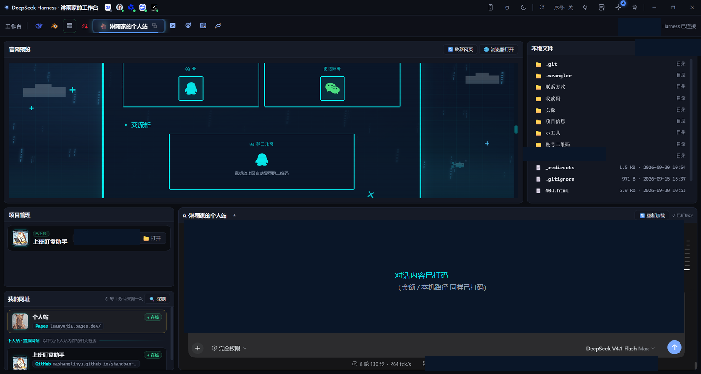

# 淋雨家的工作台

> 一套**多场景 AI 工作台**的搭建方法与纯壳模板 —— 把「一个聊天窗口」变成「一间按场景分工的工作室」。

> 🔗 **作者的个人站**：<https://luanyujia.pages.dev> —— 这套工作台的实战记录、小工具，以及**服务定制**（教培 / 托管机构的系统定制与 AI 化）。
>
> 🛒 **DSH 改造集市（持续更新）**：<https://mydsh.xyz> —— 把散在 GitHub 上的 DSH 启动动画 / 界面主题 / 插件 / 技能 / MCP / 场景收了进来，AI 检索审核整理、开源可拆、全站免费，会一直往里加。
>
> ▶ **想先看效果？** [双击这个文件](11-最小可运行壳/index.html) 就能跑 —— 单文件、零依赖、不用装任何东西。

> **作者：[淋雨家](https://luanyujia.pages.dev)**（本仓库开源，MIT）
> —— 仓库里的方法与模板，都来自这套工作台**边用边搭**的真实过程。


> ## ⚠️ 新手请谨慎：**这不是"装完就能用"的软件**
>
> 本仓库给的是**方法 + 纯壳模板**。场景配置、会话 id、面板类型、MCP 桥、脚本名……**都要按你自己的内容调试**，
> 文档里的路径**全是占位符，照抄一定失败**；不少模块（尤其 MCP）需要现场排查才能跑通。
>
> 👉 **动手前先读 [`新手必读.md`](新手必读.md)**：哪些能直接用、哪些必须自己改、最容易劝退的五件事。

---

## 读之前先认这些符号（不然会被 700+ 个尖括号劝退）

| 你看到的 | 意思 |
|---|---|
| `<DSH根>` | 你的工作台根目录（自己定一个固定文件夹，比如某个盘下建一个专用目录） |
| `<工作区>` | 会话的工作目录（新会话默认落在里面） |
| `<盘根>` | 任意盘的根（`C:\`、`D:\`…）—— 原文里写死的是某个具体盘 |
| `<场景名>` · `<面板id>` · `<客户>` · `<机主>` | 真实名字在这里被换掉了 |
| `session-0000…` | 真实会话 id 的占位（id 是私密的，换成占位才敢公开） |
| `<你的站点>` · `<服务器IP>` · `<邮箱>` · `<你的GitHub账号>` | 已脱敏的对外信息 |
| `⛔` · `★` · `⚠` | 原文的强调记号：**⛔ = 不许做** · ★ = 关键 · ⚠ = 注意 |
| `§〇` · `§一` · `§6.4` | 文档内部节号 —— 几篇之间靠它互相引用 |

> ⚠️ 这些**不是"待填的作业"**，是**脱敏后的占位**：原文里写的是某台具体机器的真实值。
> 全仓约 700 处，集中在 [`05`](05-协作与规矩/)、[`06`](06-场景实例/)、[`07`](07-顶栏与菜单栏/) 三节 ——
> **看结构就行，别试图"先把占位符填完再读"**（那是照着抄，一定不通，见新手必读 §1）。

## 这是什么

把本地 AI 助手包进一个**分场景的桌面工作台**：

- 每个场景 = 一块独立的界面（网格面板 + 一个常驻 AI 会话）；
- 每个场景的 AI **认得自己是哪个场景**：知道该读哪份记忆、该用什么技能、上次干到哪儿；
- 面板能直接预览网页、浏览文件、显示网址、看数据 —— 不只是聊天框。



> 上面就是一间**真跑着的**多场景工作台：顶上一排图标 = 各个场景（点它 = 切场景），中间是网格面板（预览 / 文件 / 项目 / 网址 / AI 对话）。
> **截图里的金额、本机路径与对话正文都已打码** —— 本仓库所有图片都按同一规矩处理，见 [`配图/README.md`](配图/README.md)。

本仓库只分享**方法与纯壳模板**，**不含任何个人内容、私密路径、密钥或业务数据**。

---

## 十二个板块（**00 是前置：先看它，其它都是它的展开**）

| # | 板块 | 一句话 | 目录 |
|---|---|---|---|
| **00** | **核心机制** ★ | **协作机制 · 记忆机制 · 场景体系** —— 这套东西真正难、也真正决定"三个月后乱不乱"的三套机制 | [`00-核心机制/`](00-核心机制/) |
| 01 | **场景模式** | 一个窗口 = 一块场景：配置格式、网格布局、面板类型、**24 种真实类型总览** | [`01-场景模式/`](01-场景模式/) |
| 02 | **会话定位与跟随** | AI 怎么知道「我是谁」，以及「我该跟着哪个窗口走」 | [`02-会话定位与跟随/`](02-会话定位与跟随/) |
| 03 | **MCP 接免费 AI** | 把网页版免费 AI 接成本地原生工具，不花 API token | [`03-MCP接免费AI/`](03-MCP接免费AI/) |
| 04 | **工作台搭建** | 从零搭一间：技术栈、目录约定、启动链路、自检、踩坑 | [`04-工作台搭建/`](04-工作台搭建/) |
| 05 | **协作与规矩** | 多个 AI 当同事怎么不乱套：宪法 / 规范 / 协作 / 身份索引 | [`05-协作与规矩/`](05-协作与规矩/) |
| 06 | **场景实例** | **11 个真跑着的场景配置**（脱敏）：面板怎么摆、会话怎么钉 | [`06-场景实例/`](06-场景实例/) |
| 07 | **顶栏与菜单栏** | 场景标签栏**源码**：建标签 / 拖拽换位 / 收起成图标 / 固定组 | [`07-顶栏与菜单栏/`](07-顶栏与菜单栏/) |
| 08 | **升级与改造清单** | 待排期清单 / 已变机制的规矩 / 还没修的坑（S/A/B/C） | [`08-升级与改造清单/`](08-升级与改造清单/) |
| 09 | **改造参考** | ★ 对**两款**成熟 agent 产品的逆向拆解（Hermes 37 篇 + workbudy 19 篇） | [09-改造参考/](09-改造参考/) |
| **10** | **源码** ★ | **真正跑着的代码**：会话绑定/轮换(687行) · 免费AI桥(360) · 三个面板实现(5,300) · 启动链路 | [10-源码/](10-源码/) |
| **11** | **最小可运行壳** ★ | **双击就能跑**的 demo（单文件）：场景切换 · 标签拖拽 · 文件→预览联动 · 换会话三处同步 | [`11-最小可运行壳/`](11-最小可运行壳/) |

另外三个附属目录（外加一份必须先读的说明）：

- [`新手必读.md`](新手必读.md) —— ⚠️ **动手前的门槛说明**：哪些能直接用、哪些必须自己调、最容易劝退的五件事
- [`模板/`](模板/) —— 可拷贝的**纯壳**（拷完必须按你自己的环境改：路径、会话 id、面板类型…）
- [`配图/`](配图/) —— 文档用的截图

---

## 文档地图（一眼看全）

```
淋雨家的工作台/
├── 工具与技能目录.md        ★ 106 个工具 / 22 个技能 / 10 个插件（只列名字与用途）
├── 更新清单.md             每次同步改了什么、故意不公开什么
├── 新手必读.md              ← ⚠️ 先读这个：能不能用、要改哪里、别踩什么
├── 00-核心机制/             ★ 三套机制 + 两专题（先看这个，其它板块都是它们的展开）
│   ├── 一-协作机制.md         规则只认机主 / 修改权分档 / 地盘与唯一对口 / 派单≠公告 / 回执闭环
│   ├── 二-记忆机制.md         记忆在文件不在会话 / 三层记忆 / 写回判据 / 4 KB 红线 / 换会话协议
│   ├── 三-场景体系.md         一个场景=一类活 / 六件套 / 怎么切分（含 10 个真实切法）
│   ├── 四-派单机制.md         完整状态机（含"未回执"）/ 四件套 / 台账与销账 / 分诊出口
│   └── 五-GPU优先.md          只有三类活能上 GPU / 退 CPU 三约束 / 验收三条 / 负载闸
├── 01-场景模式/             「壳」界面怎么搭（不涉及 AI）
│   ├── 场景配置格式.md       一份 JSON 描述一个场景（字段表 + 最小示例）
│   ├── 布局与网格.md         面板摆哪儿（col/row/w/h、六种版式）
│   ├── 面板类型与注册.md      加一个自己的面板（含可拷贝代码）
│   └── 面板通用能力.md       标题栏 / 展开 / 自刷新 / 与外壳通信
├── 02-会话定位与跟随/        「魂」AI 怎么认得自己 ★ 本仓库的核心
│   ├── 一-身份是怎么认领的.md
│   ├── 二-会话绑定三字段.md   ★ 最核心的一页（pinTarget / sessionTitle / sessionId）
│   ├── 三-跟着窗口走.md
│   ├── 四-防串台.md
│   ├── 五-换会话与归档.md
│   └── 六-记忆分三层.md
├── 03-MCP接免费AI/          「手」给 AI 接外部能力：架构 / 加站 / 排障 三篇
├── 04-工作台搭建/           「总装」从零到能跑 + 启动链路 + 自检清单 + 三起事故复盘
├── 05-协作与规矩/           「规矩」多个 AI 当同事怎么不乱套 ★ 新增
│   ├── 一-全局铁律.md         宪法层：每轮自动注入，所以必须短
│   ├── 二-标准化规范.md       规范层：判据/命令/工具清单（平时不读，按节号查）
│   ├── 三-跨场景协作.md       协作层：职能切分 / 地盘 / 重叠判据 / 派单与回执
│   └── 四-身份索引-怎么建.md   「我是谁」的唯一对照表 + 空模板
├── 06-场景实例/              ★ 11 个真跑着的场景配置（脱敏；行情分析面板留空）
├── 07-顶栏与菜单栏/           顶栏源码三段：建标签 / 拖拽与收起 / 样式
├── 08-升级与改造清单/         待排期清单 · 已变机制的规矩 · 还没修的坑（S/A/B/C）
├── 09-改造参考/              ★ 逆向拆解两款 agent 产品：Hermes（含 10-21 三轮后续：约 8 万字）· Hermes 37 篇 + workbudy 19 篇
├── 10-源码/                  ★ 真跑着的代码：会话与切换 / 免费AI桥 / 启动链路 / 三个面板实现（约 7,600 行）
├── 11-最小可运行壳/          ★ 双击 index.html 就能跑的 demo（单文件 ~600 行，零依赖）
├── 模板/                    拷走就能改的纯壳（⚠️ 拷完必须按清单改，见该目录 README）
└── 配图/                    文档配图（3 张实拍已打码 + 2 张架构图）
```

## 三种读法（你是哪种读者）

| 你是哪种人 | 怎么读 |
|---|---|
| **只是好奇**这是什么 | 上面「这是什么」→ [新手必读](新手必读.md) §1 那张「哪些能直接用 / 哪些必须自己调」的表 |
| **想搭一个自己的** | [新手必读](新手必读.md) §4 的六步（每步有验收标准）→ [01](01-场景模式/) → [02](02-会话定位与跟随/) → [04](04-工作台搭建/) |
| **已经搭着、卡在某个症状上** | 直接翻各篇末尾的**「症状对照」**表：[01 配置格式](01-场景模式/场景配置格式.md)、[02 绑定三字段](02-会话定位与跟随/二-会话绑定三字段.md)、[03 排障](03-MCP接免费AI/) |

---

## 为什么这么分（划分逻辑）

五块对应五件**可以独立看懂、独立替换**的事：

| 板块 | 是什么 | 换个说法 |
|---|---|---|
| 01 场景模式 | **壳** | 纯 UI 与配置，不涉及 AI。想换界面只动这里 |
| 02 会话定位与跟随 | **魂** | 工作台和「多标签浏览器」的根本区别就在这：AI 有身份、有记忆、认窗口 |
| 03 MCP 接免费 AI | **手** | 给 AI 接外部能力，而且不花 API 钱 |
| 04 工作台搭建 | **总装** | 把前三个装成一台能跑的机器 |
| 05 协作与规矩 | **规矩** | 多个 AI 当同事时的边界与闭环：谁该做什么、踩了怎么办、记忆堆哪儿 |

顺序上也是**依赖顺序**：先有 01 的壳，才谈得上 02 绑会话；01 + 02 跑通之后再接 03；04 是把三者合起来的上手路径。
05 不太一样 —— **它不是"搭"出来的，是被事故逼出来的**：等你真开着 3 个以上会话同时干活，那些坑你一个都躲不掉。

---

## 建议的上手顺序

0. **先读 [`新手必读.md`](新手必读.md)** —— 它不是客套话：这个仓库里"抄了不能用"的地方都列在那一页；
1. 读 [`04-工作台搭建/`](04-工作台搭建/) 的「从零到能跑」—— 先建立全局印象（正文已上：六步，每步都有验收标准）；
2. 照 [`01-场景模式/`](01-场景模式/) 定义你自己的第一个场景（先用占位面板，不接 AI）；
3. 照 [`02-会话定位与跟随/`](02-会话定位与跟随/) 把 AI 绑上去，让「切场景 = 切脑子」成立（**会话 id 必须是你的**）；
4. 需要省 token 时再看 [`03-MCP接免费AI/`](03-MCP接免费AI/)，把网页版 AI 接成工具 —— **这块最需要现场调试，别第一个上**。

> 每一步都有验收标准，写在 [`新手必读.md`](新手必读.md) §4：**看得见的落点才算过**（面板在位 / 画面切对 / 工具返回真实回答）。

---

## 状态

📗 **正文持续补充中** —— 目前已完成：

- ✅ [01 · 场景模式](01-场景模式/) —— 四篇全齐（配置格式 / 布局与网格 / 面板类型与注册 / 面板通用能力）
- ✅ [02 · 会话定位与跟随](02-会话定位与跟随/) —— 六篇全齐（**核心是[会话绑定三字段](02-会话定位与跟随/二-会话绑定三字段.md)**）
- ✅ [05 · 协作与规矩](05-协作与规矩/) —— **四篇齐了**：全局铁律 / 标准化规范 / 跨场景协作 / 身份索引怎么建（三份是**从真跑着的机器上脱敏下来的原文**，保留原味）
- ✅ [06 · 场景实例](06-场景实例/) —— **10 份真实场景配置**（面板类型/网格坐标/钉会话全在里面；行情分析按要求**面板留空**）
- ✅ [07 · 顶栏与菜单栏](07-顶栏与菜单栏/) —— 场景标签栏**源码三段**：建 DOM / 拖拽换位+收起成图标 / 样式
- ✅ [08 · 升级与改造清单](08-升级与改造清单/) —— 待排期（P0/P1/P2）· **已变成机制**的 9 条规矩 · 未修的坑（S/A/B/C 四级）
- ✅ **本轮新增四篇**：`01` [面板类型总览](01-场景模式/面板类型总览.md)（24 种 / 7 族 + 最小实现要点）· `04` [事故复盘-三起](04-工作台搭建/事故复盘-三起.md)（三起真事故 + 机械抓手）· `08` [把规矩变成机制](08-升级与改造清单/把规矩变成机制.md)（五步法）· `模板` [MCP-站点薄壳.mjs](模板/MCP-站点薄壳.mjs)（5 处 TODO 填完就能接）
- ✅ [09 · 改造参考](09-改造参考/) —— **37 篇逆向拆解笔记**：索引 / 侦察 / **16 篇主线**（上下文压缩、验证、失败恢复、本地模型、注入防御…）/ **17 篇证据** / 改造清单 / 未解问题。⚠ 只公开"方法与结论"三层，**不含**被观察产品的源码或提取出来的 schema
- ✅ **另加两篇专题**：[四-派单机制](00-核心机制/四-派单机制.md)（状态机 + 台账 + 销账 + 分诊）· [五-GPU优先](00-核心机制/五-GPU优先.md)（三类可加速 / 退 CPU 三约束 / 验收三条 / 负载闸）
- ✅ [10 · 源码](10-源码/) —— **8 个源文件 / 约 7,600 行 / 395 KB**：sessions + 换会话（心脏）· webai 桥 · 启动链路两段 · file / view / harness 三个面板完整实现。⚠ 全部通过 node --check，脱敏 0 残留
- ✅ [11 · 最小可运行壳](11-最小可运行壳/) —— **单文件 demo**：3 个场景 / 拖拽换位不误切 / 文件→预览联动 / 换会话三处同步提示。已用无头浏览器实跑验证（3 标签 + 3 面板 + 状态栏正常）
- ✅ [模板](模板/) —— 两个纯壳场景 + 一个面板渲染器 + 两份记忆模板 + **一份「外部客户运维」空模板**
- ✅ [配图](配图/) —— **5 张齐了**：3 张实拍（按坐标打码：金额 / 本机路径 / 对话正文 / 用量统计）+ 2 张架构图（四层架构 / 启动链路）
- ✅ [03 · MCP 接免费 AI](03-MCP接免费AI/) —— **整体架构 / 怎么加一个站 / 排障** 三篇（余 2 篇待补）
- ✅ [04 · 工作台搭建](04-工作台搭建/) —— **从零到能跑 / 技术栈与启动链路 / 自检清单 / 事故复盘-三起**（余 1 篇待补）

> 已完成的部分都经过一次**公开内容体检**（客户名 / 盘符路径 / 真实会话 id / 内部实现名 / 站点与账号 / IP / 密钥格式，全仓扫描）与**链接有效性检查**。
> 05 的三份原文发布前逐份跑过脱敏器：替换 311 处、残留 **0 处**（扫描器命中即拦，不许提交）。

想第一时间拿到更新：**Watch → Custom → Releases**，或先 **Star** 收藏。

---

## 作者

**淋雨家** —— 一个人在用、边踩坑边写下来的工作台。

| | |
|---|---|
| 个人站 | <https://luanyujia.pages.dev> |
| GitHub | 本仓库 |
| 同作者的另一套东西 | 个人站首页「小工具」区（含本仓库的入口卡片） |

这套工作台不是设计出来的，是**用出来的**：仓库里每条结论背后都对应一次真实事故
（所以各板块都带「症状对照」——那是踩坑记录，不是免责声明）。
有问题欢迎开 Issue；也欢迎直接到个人站找我。

---

## 许可

**MIT** —— 随内容一起提交 `LICENSE`。

---

<p align="center">
  <sub>作者 <b>淋雨家</b> · 个人站 → <a href="https://luanyujia.pages.dev">luanyujia.pages.dev</a></sub>
</p>

---

> 📅 **最后更新**：2026-10-24（新增 `程序开发` 场景配置、`.gitignore` 公开边界、`更新清单.md`；规则同步 10-22 临时目录新口径）
