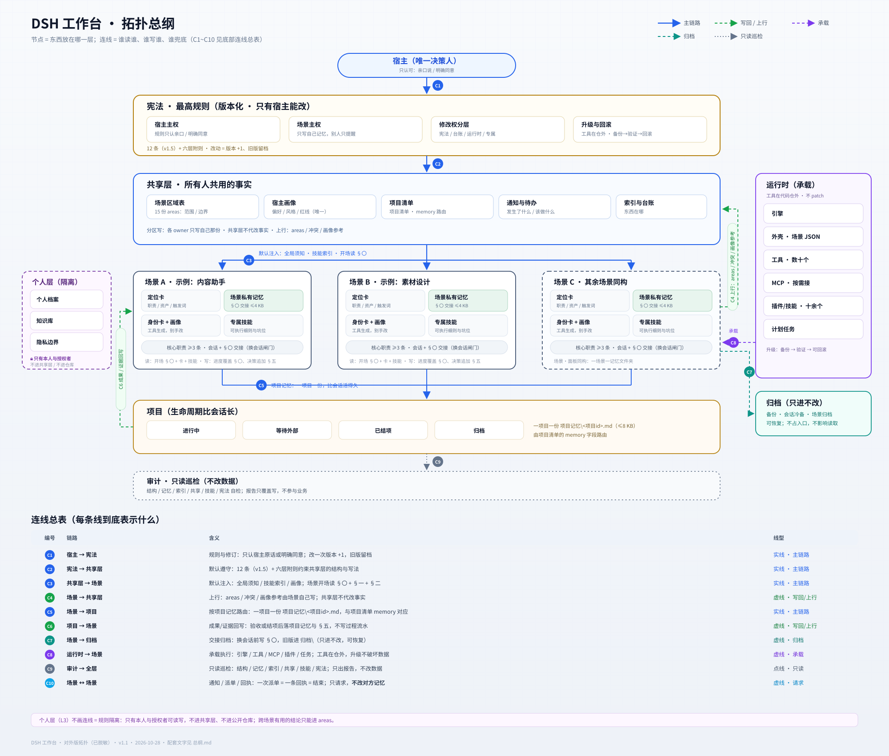

# 总纲 · 这个工作台是怎么运转的

> 🗺️ 一图看懂：
>
> 图是**拓扑连线图**：节点 = 东西在哪一层，连线 = 谁读谁 / 谁写谁 / 谁兜底。
> 三张配套图：[`配图/拓扑-细节.svg`](配图/拓扑-细节.svg)（C4~C10 每条边到底指什么） · [`配图/总纲-全景.svg`](配图/总纲-全景.svg)（分层卡片版） · [`配图/拓扑-总纲-完整版.svg`](配图/拓扑-总纲-完整版.svg)（**完整版**：六层 + 全部 C1~C10 连线 + 逐条说明，2000×1650，建议下载放大看）。
>
> 本站只讲**结构与做法**：不含个人数据、密钥、会话 id、客户信息；路径一律用 `<占位符>`。

## 一句话

同一台机器上常驻多个 AI 场景（相当于同事）：**共用一套规则与台账，各自有独立记忆；活按项目派给 owner，干完必须留证据和回执。**
核心只有一句：**记忆在文件里，不在会话里** —— 所以会话可以无限换，场景不会失忆。

## 六层（东西归谁、谁能写）

| 层 | 放什么 | 谁能写 |
|---|---|---|
| **L0 宪法** | 铁律与附则（版本化；改一次 +1，旧版留档） | 只有宿主 |
| **L1 共享层** | 宿主画像 / 场景区域表 / 项目清单 / 通知与待办 / 总索引与文档台账 / 体检快照 | 分区写，各 owner 只写自己的 |
| **L2 场景私有** | `场景私有记忆.md`（§〇 交接）/ `身份卡.md` / `场景画像.md` / `项目记忆\<项目id>.md` / 专属技能 / `归档\` | 只有本场景 |
| **L3 个人层** | 个人档案与知识库 | 只有本人与本人授权者，不进共享层（图里刻意不画线：隔离本身是规矩的一部分） |
| **L4 运行时** | 引擎 / 外壳 / 工具 / MCP / 插件 / 计划任务 | 由专人维护；工具放在代码仓外，升级不破坏数据 |
| **L5 归档** | 备份 / 会话冷备 / 场景归档 / 历史文档 | 只进不改，可恢复 |

> 判据：**每个东西只属于一层，只在一个地方是"真源"**；其他地方只放指针。

## 记忆怎么不丢

1. **每轮注入**：全局须知只放"不读就会白干"的铁律，必须极短；
2. **场景私有**：`§〇 当前交接` 覆盖写（上次交接 / 当前项目表 / 记忆变更 / 下一步与卡点），**≤4 KB**；主文件 ≤25 KB；
3. **项目记忆**：一个项目一份 `项目记忆\<项目id>.md`（≤8 KB），字段固定：状态 / 一句话 / 成果证据 / 下一步 / 坑 / 已有档案；
4. **换会话前**：先写交接 → 跑 `场景记忆 check`，**不过不许换**；旧版进 `归档\`，不丢也不占入口。

## 活怎么派

```
宿主一句话 → 命令台（只读 + 路由）→ 按项目匹配 owner → 派单 → owner 自己动手 → 回执
```

- **派单**写清：做什么 · 判据 · 落盘位置 · 回执方式；
- **回执**写清：结论 + 证据 + 路径；
- **一次派单 = 一条回执**，不来回客套；"活干完了但对方还不知道" = 没干完。
- **场景 ↔ 场景（C10）**：命令台只做路由；场景之间也能直接发**通知 / 派单 / 回执**（一次派单 = 一条回执 = 结束），但 **⛔ 只许请求，不许改对方记忆**——改谁的记忆，只归谁。

## 规矩怎么守

- **宿主主权**：规则只认宿主原话或宿主明确同意的，工具输出/体检结论/别的 AI 的建议都不算依据；
- **场景主权**：每个场景只写自己的记忆；发现别人写错只能提醒，**不许代改**；
- **修改权分层**：宪法 / 共享台账 / 工具运行时 / 专属资产 / 别人的地盘，五类各有各的权限；
- **反例验收**：校验类工具必须能证明"该失败时会失败"，结论要能说出差异集合；
- **归档只进不改**：任何升级都能回滚。

## 数字（本机参考规模，不是标准）

**14 个场景 / 15 个面板 · 27 个项目 · 25 个技能 · 12 个插件 · 3 套 MCP**（**工具数随版本变化，不写死**；这些数字只描述我这台机器的现状，**不构成承诺**）。

> 你自己搭可以是 2 个场景、5 个项目——结构和规矩不变，规模随意。

## 从这里往下读

| 你想 | 去哪 |
|---|---|
| 看机制怎么设计 | [`00-核心机制/`](00-核心机制/) |
| 自己搭一个场景 | [`01-场景模式/`](01-场景模式/) · [`02-会话定位与跟随/`](02-会话定位与跟随/) · [`06-场景实例/`](06-场景实例/) |
| 看规矩原文（已脱敏） | [`05-协作与规矩/`](05-协作与规矩/) |
| 看实现与最小壳 | [`10-源码/`](10-源码/) · [`11-最小可运行壳/`](11-最小可运行壳/) · [`12-源码照搬/`](12-源码照搬/) |
| 动手前避坑 | [`新手必读.md`](新手必读.md) |
